# Mermaid

Make the visualization part of the ordinary Markdown answer. Use a fenced `mermaid` block next to the short prose it clarifies; do not create a separate artifact unless the user asks for one.

## Choose by meaning

- Process, branching, dependencies, data flow → `flowchart`
- Calls and interactions over time → `sequenceDiagram` or `zenuml`
- Domain structure or data model → `classDiagram` or `erDiagram`
- Lifecycle and transitions → `stateDiagram-v2`
- Architecture → `C4Context`, `C4Container`, `architecture-beta`, or a flowchart with boundaries
- Roadmap and schedule → `timeline` or `gantt`
- Hierarchy and decomposition → `mindmap`, `treemap-beta`, or `block-beta`
- Work and prioritization → `kanban` or `quadrantChart`
- Quantitative comparison → `xychart`, `pie`, `radar-beta`, or `sankey-beta`
- Binary or protocol layout → `packet-beta`

Do not force every idea into a flowchart. Pick the grammar whose semantics match the relationship.

## Rules

- Show one useful idea per diagram. Split diagrams when crossings or density hide the point.
- Preserve truthful order, direction, cardinality, boundaries, units, and scale. Never invent data to make a chart look complete.
- Use real labels from the task. Add subgraphs, participants, states, series names, and notes only when they carry meaning.
- For charts, label units, choose an honest axis range, and name multiple series. Use color as reinforcement, not the only carrier of meaning.
- Keep surrounding prose short and do not narrate what the diagram already makes obvious.
- Renderer support varies for beta diagrams, C4, and ZenUML. Check the current syntax when uncertain and fail visibly rather than silently replacing the requested visualization with a weaker fallback.
- Mermaid is for compact inline explanation, not polished interactive charts, geographic maps, or spatial UI mockups.

## bb IDE renderer: mandatory frontmatter

When the diagram renders in bb chat (any bb thread), always start the mermaid block with this frontmatter. Verified root causes, do not drop pieces of it: bb initializes mermaid with font `Inter` while the app renders `Inter Variable`, so HTML labels are measured narrower than they render and get clipped (`htmlLabels: false` makes measurement and render use the same SVG font); mermaid's own state-diagram styles hardcode `opacity: 0.5` on edge-label plates, which only `themeCSS` can override (it is not in the strict-mode secure list).

```yaml
---
config:
  htmlLabels: false
  flowchart:
    htmlLabels: false
  themeCSS: ".edgeLabel rect, .edgeLabel .label rect, .stateLabel .box { opacity: 1 !important; fill: #ffffff; }"
  themeVariables:
    edgeLabelBackground: "#ffffff"
    labelBackgroundColor: "#ffffff"
---
```

Notes: `#ffffff` assumes bb light theme. `stateDiagram` transition labels have no auto-wrap even in SVG mode — keep each label line short and break long labels with `<br/>`; there is no knob for explicit label-box size. Font-family overrides (`Inter Variable` etc.) do NOT fix the clipping — tested.

## Examples

Process with boundaries:

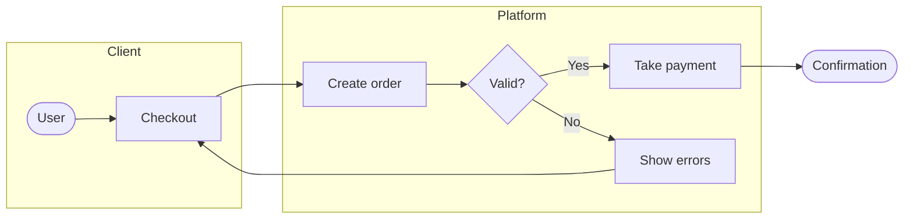

Interaction with alternatives:

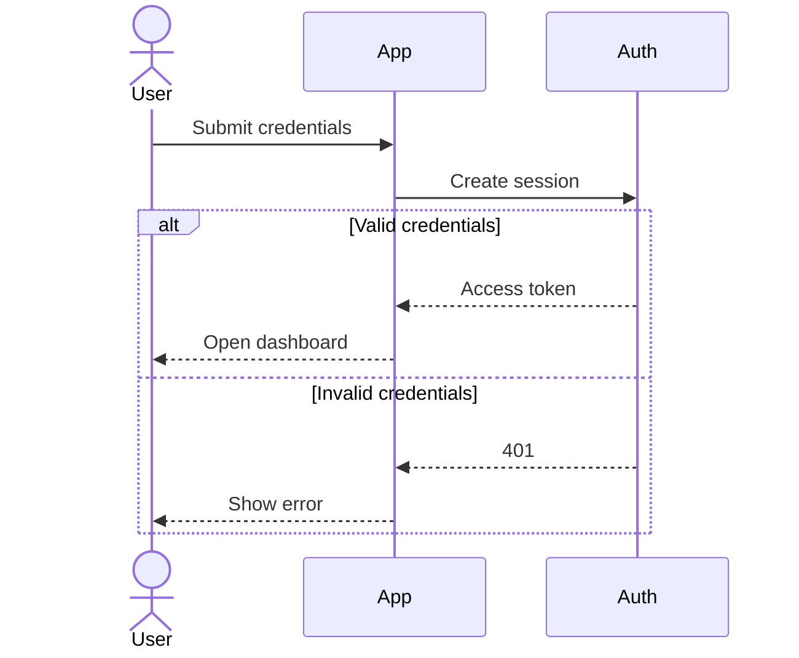

Chart with named series and non-zero axes:

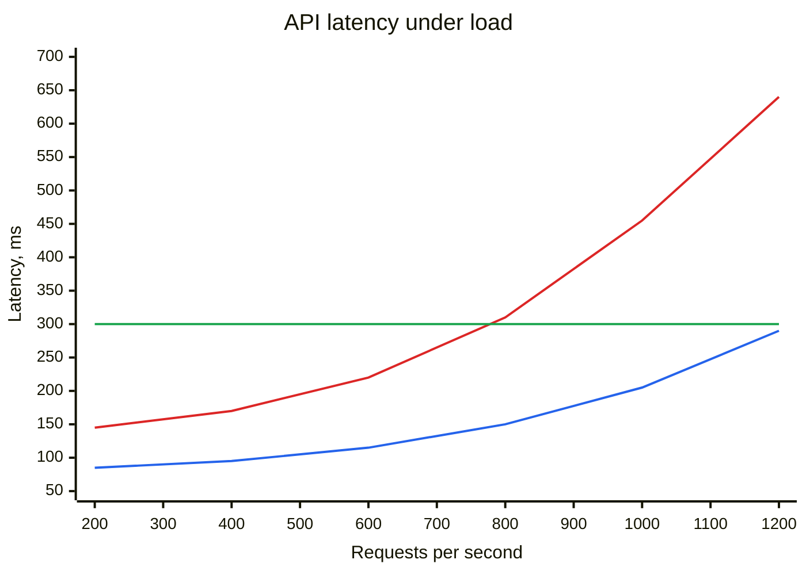

Protocol layout:

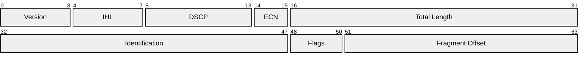

Lifecycle with explicit transitions:

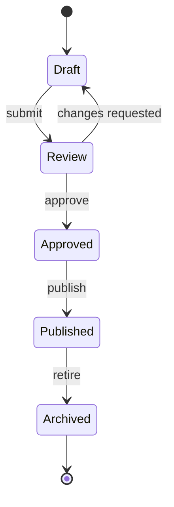

Relational data model:

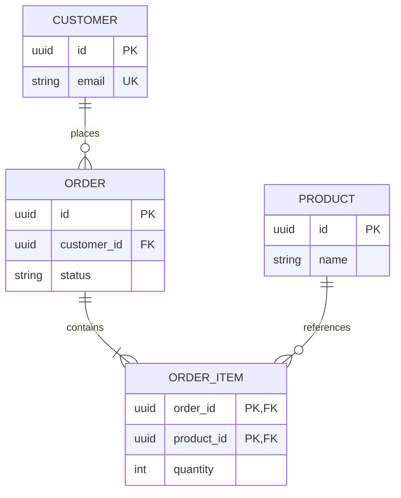

Schedule with dependencies and a milestone:

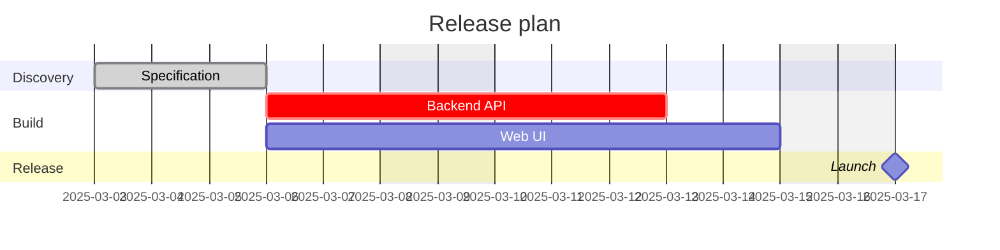

Hierarchy and decomposition:

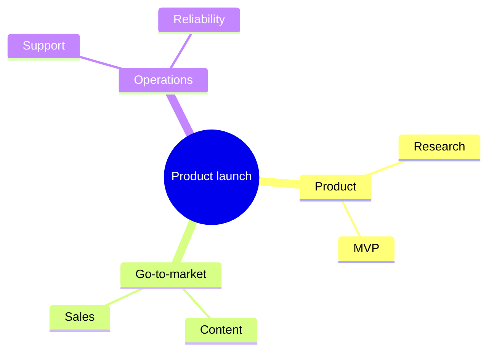

Prioritization by two dimensions:

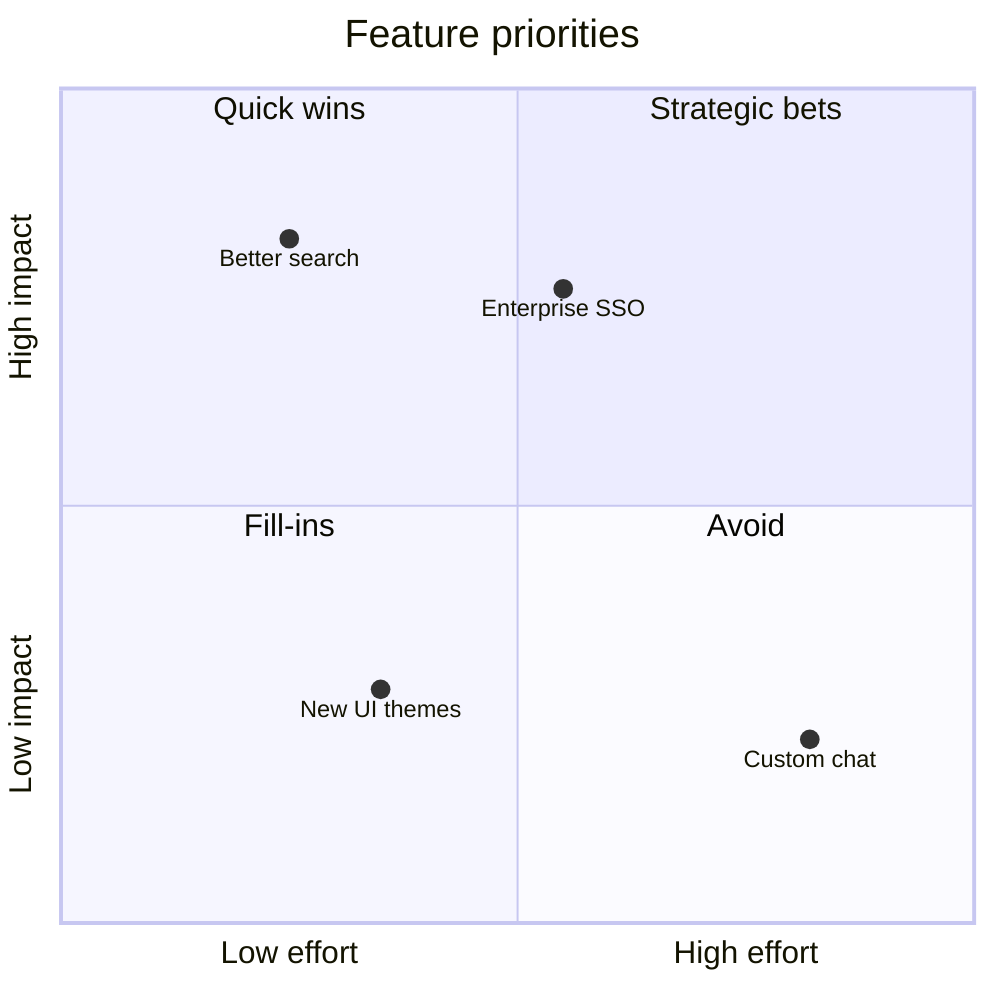

Work moving through stages:

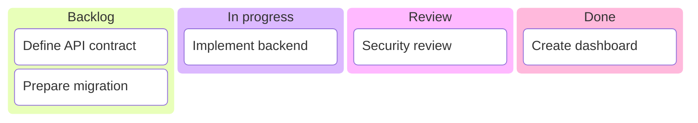

Part-to-whole comparison:

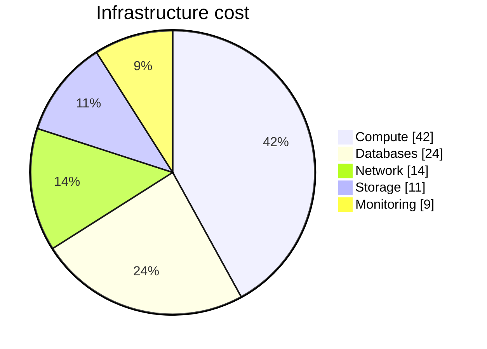

Architecture with explicit boundaries:

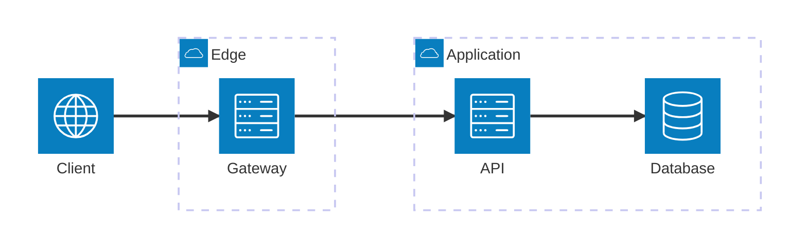

## Documentation

- [Mermaid documentation](https://mermaid.js.org/intro/)
- [Diagram syntax reference](https://mermaid.js.org/intro/syntax-reference.html)
- [Mermaid Live Editor](https://mermaid.live/)
